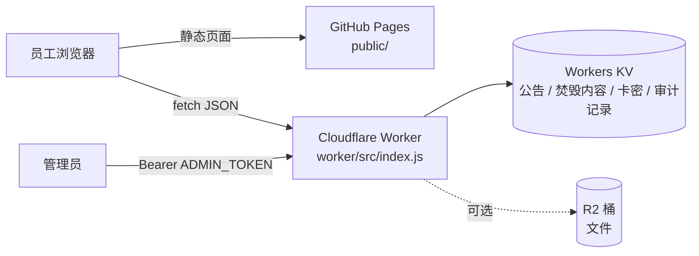

# 企业内部信息发布系统

基于 **GitHub Pages + Cloudflare Workers + Workers KV** 的零服务器内部发布系统，包含三个模块：

1. **内部公告**：长期展示的常规通知，全员可浏览；
2. **阅后即焚公告**：一次性查阅，后端读取即删除；前端集成防截屏 / 防录屏 / 防复制 / 开发者工具检测，触发即黑屏锁定；
3. **卡密取文件**：核验卡密后展示文本、跳转链接或从 R2 桶下载文件，支持单次 / 多次使用、过期时间、次数限制。

> 所有校验、卡密、涉密内容都在 Worker 后端处理，前端页面不包含任何明文密钥。

---

## 一、架构



- **前端**：纯静态 HTML/CSS/JS，部署在 GitHub Pages；
- **后端**：单个 Worker 脚本，边缘执行，无冷启动；
- **存储**：一个 KV 命名空间即可跑通全部功能；R2 为可选，用于卡密分发文件。

## 二、目录结构

```
internal-notice-portal/
├── public/                     # GitHub Pages 前端
│   ├── index.html              # 公告首页
│   ├── burn.html               # 阅后即焚阅读页（含风控闸门）
│   ├── file.html               # 卡密取文件
│   ├── admin.html              # 管理后台
│   ├── robots.txt
│   └── assets/
│       ├── config.js           # ← 部署后唯一需要改的前端配置
│       ├── app.js              # 通用请求 / 转义工具
│       ├── guard.js            # 防截屏录屏风控模块
│       └── style.css
├── worker/
│   ├── src/index.js             # Worker 后端（全部接口）
│   ├── wrangler.toml
│   └── package.json
├── docs/
│   └── 管理员操作手册.md
└── .github/workflows/pages.yml # 推送后自动部署 Pages
```

## 三、部署步骤

### 1. 前端（GitHub Pages）

1. 将本仓库推送到 GitHub（公开仓库免费版 Pages 即可使用）；
2. 仓库 **Settings → Pages**，Source 选择 **GitHub Actions**；
3. 推送 `public/` 后，`.github/workflows/pages.yml` 会自动发布；
4. 记下 Pages 地址，例如 `https://kang-tommy.github.io/internal-notice-portal`。

### 2. Worker 后端

前置：安装 Node.js 18+，登录 Cloudflare：

```bash
cd worker
npm install
npx wrangler login
npx wrangler kv namespace create KV
```

把返回的 KV `id` 填进 `wrangler.toml` 的 `[[kv_namespaces]]`。

设置管理员密钥（随机 32 位以上，不要写进代码）：

```bash
npx wrangler secret put ADMIN_TOKEN
```

（可选）如需卡密分发文件，在 Cloudflare 控制台创建 R2 桶，在 `wrangler.toml` 取消注释 `[[r2_buckets]]` 并填入桶名。

部署：

```bash
npx wrangler deploy
```

记下 Worker 地址，例如 `https://notice-portal-api.<account>.workers.dev`。

### 3. 对接前端

编辑 `public/assets/config.js`：

```js
API_BASE: 'https://notice-portal-api.<account>.workers.dev',
ORG_NAME: '你的企业名称',
SYSTEM_NAME: '内部信息发布平台',
```

编辑 `worker/wrangler.toml`：

```toml
PAGES_URL = "https://kang-tommy.github.io/internal-notice-portal"
ALLOWED_ORIGINS = "https://kang-tommy.github.io"
```

提交并推送，等 Actions 部署完成即可使用。

> 生产建议：给 Worker 绑定自己的企业子域名（如 `notice-api.example.com`）。`*.workers.dev` 域名在部分网络环境下不稳定，且容易被拦截。

## 四、接口一览

| 方法 | 路径 | 权限 | 说明 |
| --- | --- | --- | --- |
| GET | `/api/notices` | 公开 | 公告列表（置顶优先，时间倒序） |
| GET | `/api/notices/:id` | 公开 | 公告详情 |
| POST | `/api/burn` | 公开（限流） | 用 token 换取焚毁内容，同时删除 |
| POST | `/api/card` | 公开（限流） | 校验卡密，返回文本 / 链接 / 一次性下载地址 |
| GET | `/api/dl/:token` | 一次性 | 从 R2 下载文件 |
| POST | `/api/report` | 公开（限流） | 风控行为上报，留痕审计 |
| POST | `/api/admin/notices` | 管理员 | 发布公告 |
| PUT | `/api/admin/notices/:id` | 管理员 | 修改公告 |
| DELETE | `/api/admin/notices/:id` | 管理员 | 删除公告 |
| POST | `/api/admin/burn` | 管理员 | 生成一次性焚毁链接 |
| GET | `/api/admin/cards` | 管理员 | 卡密列表（不含明文卡密） |
| POST | `/api/admin/cards` | 管理员 | 生成卡密 |
| POST | `/api/admin/cards/revoke-by-hash` | 管理员 | 按 hash 前缀停用卡密 |

## 五、免费额度与限制（Cloudflare 免费版）

| 项目 | 免费额度 | 本项目的消耗方式 |
| --- | --- | --- |
| Worker 请求 | 10 万次 / 天 | 公告、核验、下载都计入 |
| Worker CPU 时间 | 10 ms / 请求 | 校验、读写 KV 远低于此限 |
| KV 存储 | 1 GB | 公告 / 焚毁内容 / 卡密 |
| KV 读取 | 10 万次 / 天 | 浏览公告、核验卡密 |
| KV 写入 / 删除 | **1000 次 / 天** | 发布公告、生成焚毁链接、生成卡密、失败限流计数 |

> KV 写入是最紧的额度：日常只在管理员发布内容、卡密核验成功、失败被限流时写入。个人 / 小团队使用基本够用；规模化使用前请评估升级方案。

## 六、安全能力边界（务必先读）

浏览器**无法从系统层面禁止截图**，本项目风控是「抬高成本 + 触发即销毁 + 留痕追责」，不是绝对防线：

**能检测并黑屏：**
- 右键菜单、复制 / 剪切 / 拖拽选中文本；
- 浏览器截图快捷键（PrintScreen、macOS Cmd+Shift+3/4/5）；
- 开发者工具（F12、Ctrl/Cmd+Shift+I/J、窗口尺寸异常、debugger 暂停）；
- 页面脚本调起的屏幕共享 / 录屏（`getDisplayMedia`）；
- 页面失焦、切到后台（打开截图 / 录屏工具通常会导致失焦）；
- 打印操作、画中画、页面被嵌入 iframe。

**检测不到 / 拦不住：**
- Windows `Win+Shift+S` 等系统截图、第三方截图工具全局热键；
- 直接抓取桌面的录屏软件、远程控制软件；
- 手机拍屏、外接采集卡；
- 已经离开页面后的二次传播。

涉密场景请同时配合：动态水印追责、终端 DLP 管控、保密协议、设备准入。真正不能外传的内容，不要通过任何网页系统承载。

## 七、本地开发

```bash
# 后端
cd worker
npm install
npx wrangler dev        # 本地 http://localhost:8787

# 前端：任意静态服务器
cd public
npx serve .             # 或 VS Code Live Server
```

前端 `config.js` 里把 `API_BASE` 指到本地 Worker，`ALLOWED_ORIGINS` 加上 `http://localhost:8080`。

## 八、合规提醒

本系统用于企业内部合法的通知与资料分发。请勿用于存储、传播违法违规内容；Cloudflare 会对违规站点采取措施。卡密、公告、文件的内容合法性由使用方自行负责。
